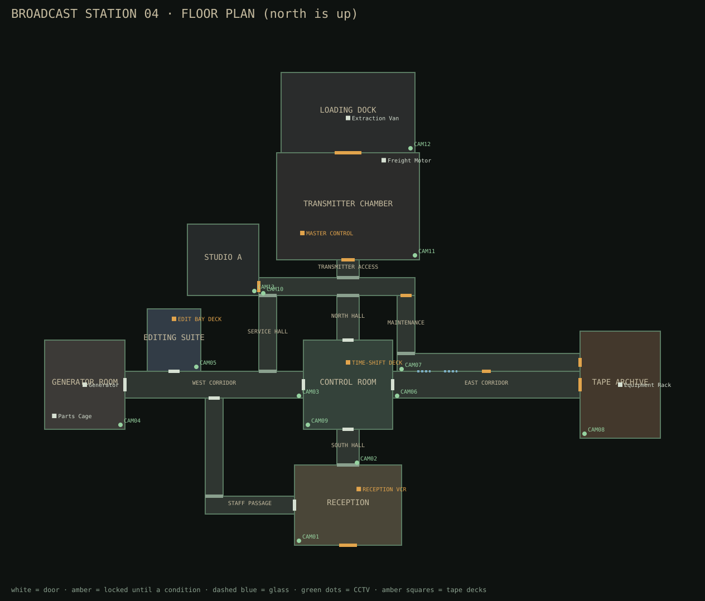

# DEAD AIR: CHANNEL ZERO

*A first-person analog-horror survival mystery for 1–4 players, built for Roblox.*

> "The recording isn't showing you the past. It's showing you what happens next."

In 1997 a regional television station shut down. Nineteen years later it starts
transmitting at 00:00 every night, and the broadcast shows events inside the
building **before they happen**. You work for the National Broadcast Recovery
Division. Your job: get in, recover the transmission components, shut the
broadcast down and get out.

The twist is the **Time-Shift Deck**. Tapes show the future. You can change a
small number of predicted conditions: keep a light on, hold a door, move where
something will be. Every change has an authored consequence somewhere else in the
station.

This repository is the whole game as a [Rojo](https://rojo.space) project: every
script, the UI, the map (built in code), the Presenter, the case data, and a test
suite that runs the real code headlessly.

---

## Contents

1. [Status: what is done and what is not](#status)
2. [Opening it in Roblox Studio](#opening-it-in-roblox-studio)
3. [How to play Case 01](#how-to-play-case-01)
4. [Controls](#controls)
5. [How the game is built](#how-the-game-is-built)
6. [Tests and checks](#tests-and-checks)
7. [Before you publish](#before-you-publish)
8. [Adding content](#adding-content)

---

## Status

**Built (Stages 1–5 of the brief, for Case 01):**

| Area | What exists |
| --- | --- |
| Core mechanic | Time-Shift Deck with tapes, cameras, a footage viewport, a scrubber with event markers, play/pause/frame-step, event details (original / predicted / proposed), allowed alternatives, linked-event warnings with clues, charge cost, commit/cancel/close, and a reason shown for every blocked edit. Edits are validated and committed on the server and never spend a charge when invalid. |
| Case 01 | *The 00:17 Transmission* in Broadcast Station 04. 4 tapes; 4 editable events, each with an authored consequence; 3 shared charges (2 in Restricted). The Presenter, the Loop and the Caller. 3 components, generator, keypad, relays, transmitter key, freight-door climax, extraction, an optional risk room (Studio A) and 5 evidence tapes. |
| The Presenter | States: Dormant, Observing, Displaced, Hunting and Rewinding. Server-side state machine with pathfinding, line of sight (sees through glass), light/flashlight-dependent sight, a wind-up before every hunt, lose-and-search, a hunt time limit, soundproof refuge rooms, and revive protection. It follows the *committed timeline*, not the light switches. |
| Map | Broadcast Station 04, built in code: reception lobby, control room, tape archive, editing suite, generator room, east corridor, transmitter chamber, plus staff passage, service halls, maintenance passage, Studio A and the loading dock. Hinged, double and freight doors; fluorescent and emergency lighting; CCTV cameras; signage; furniture. Also the Division field office (HQ). |
| UI | Main menu (camera pan, Case Select, Evidence Archive, Equipment, Settings, Credits, Store), HUD laid out as the brief specifies, case report, spectator screen, keypad, pause menu. PC, mobile (touch buttons, tap prompts) and gamepad (prompts, bindings, selectable buttons). |
| Progression | DataStore saves with session locking. Credits, research, clearance, evidence archive, case-tape replay with hidden frames, seven master-recording slots, challenges, cosmetics, loadout presets, desk decorations, Restricted mode and a weekly Archive Challenge with a leaderboard. |
| Monetisation | Five gamepasses and four developer products, all cosmetic or convenience. Receipts are processed server-side exactly once. Re-entry is once per case, at a safe checkpoint, after a short delay. The game is completable for free. |
| Accessibility | Subtitles for every important cue, a radio log, sliders for sensitivity, camera shake, distortion, flicker, text size and four audio groups, and a low-intensity mode that keeps all information. |

**Not built yet:**

* **Cases 02–07** and the final destroy / preserve / broadcast choice. The brief
  says to add more cases only after Case 01 is stable. Case Select and the archive
  already show the campaign's seven slots.
* **Audio assets.** The project ships no third-party sounds. Only two
  engine-bundled sounds are used. Every cue is wired up with a subtitle and a
  visual, and `src/shared/Config/Audio.luau` lists each cue with Creator Store
  search terms. Paste licensed `rbxassetid://` ids there.
* **Monetisation IDs.** All pass and product ids are `0`, so the store is hidden,
  until you create them on the Creator Dashboard (see [Before you publish](#before-you-publish)).
* **Personal Quarters** is a decorated desk in the field office, not a separate room.

**Not tested yet:** nothing has been run in Roblox Studio. Everything below was
verified headlessly (see [Tests and checks](#tests-and-checks)): the logic, a
simulated full playthrough, the geometry and the API names. Physics, real
pathfinding, rendering, lighting, feel and performance on devices all still need
a play test in Studio. Expect tuning.

---

## Opening it in Roblox Studio

**Option A — open a built place file.** Run `scripts/build.sh`. It runs the
tests, builds with Rojo and bakes the map in, producing `build/DeadAir.rbxl`.
Open that in Studio: the station is in `Workspace`, ready to edit.

**Option B — live sync with Rojo** (recommended while developing):

1. Install the toolchain from `rokit.toml` (`rokit install`), or install
   Rojo 7.7.1, Lune 0.11.1, selene 0.31 and StyLua 2.6 any other way.
2. Install the Rojo plugin in Studio.
3. Run `rojo serve` in this folder and click **Connect** in the plugin.
4. Press **Play**. If `Workspace` has no `Station04`, the server builds the
   map at runtime.

Settings to change in Studio (they can't live in the project file):

* **Game Settings → Players → Max players: 4.** A case holds 4 investigators.
* **Game Settings → Security → Enable Studio Access to API Services** if you
  want saves to work in Studio. Without it the game runs on a session-only
  profile and says so.

---

## How to play Case 01



*Generated from the game's own layout data with `lune run scripts/mapsvg.luau`.*

1. **Field office.** Pick equipment at the locker, then *Ready* at the case
   board. When everyone in the office is ready, the team deploys. Solo works.
2. **Briefing** (40 s). Division explains the rules over Channel 2.
   *Division only speaks on Channel 2 and stamps messages with the live tape clock.*
3. **TAPE 01** is on the reception desk. Play it on the reception VCR. The
   footage predicts that the lights fail at 00:02:30 and something walks in
   through the main doors.
   * Leave it, and you need to be out of reception by then.
   * Edit it (*LIGHTS HOLD*) and the figure waits outside the control room
     instead. Take the staff passage.
4. **Power.** The generator room is at the end of the west corridor. Prime the
   pump, then pull the starter. Power unlocks the electronic doors, the CCTV and
   the main Time-Shift Deck.
5. **The Caller.** Division radios the parts-cage code on CH2. Then a "correction"
   arrives on CH0 with the wrong timestamp. The wrong code sets off the alarm.
6. **TAPE 02** (editing suite): about 90 seconds after power, the east corridor
   lights fail and it patrols the corridor in the dark. You can keep them lit,
   but then it occupies the control room. Either way the maintenance passage is
   your way east. Mind the windows.
7. **The Loop** (tape archive). Taking the sync board traps you in a repeating
   room. On every second cycle one detail is different. Touch that detail. A
   wrong guess only restarts the loop.
8. **TAPE 03** shows the archive ambush 20 seconds after you take the board, and
   the control room rewinding itself a minute later.
9. **Transmitter.** Use the key from the archive and install the three
   components. **TAPE 04**: the freight door jams, and you restart the motor
   while it hunts the chamber. Or edit the door to open on time, and it patrols
   the loading dock instead.
10. **Extraction.** Board the van. Studio A unlocks at the end, with TAPE 07 inside.
    It's optional, and it's never free.

A standard run takes 12–18 minutes. Grades run D–S and reward survival, evidence,
predictions interpreted before they happened, and smart use of charges, not speed.

## Controls

| Action | PC | Mobile | Controller |
| --- | --- | --- | --- |
| Interact | E | tap the prompt | X |
| Equip tool | 1 | Tool button | D-pad up |
| Open deck | R | Deck button | Y |
| Sprint | Shift (hold) | Sprint button | L3 |
| Inspect | hold right mouse | hold Inspect | hold L2 |
| Flashlight | F | Light button | D-pad down |
| Menu / pause | Tab or P | Menu button | Select |

Esc stays the Roblox menu, which Roblox reserves. In the deck, use Space for play
and pause, ←/→ to step a frame, and B or Backspace to close.

---

## How the game is built

```
src/
  shared/          ReplicatedStorage.Shared — used by server, client and tests
    Config/        MapLayout, Case01, Evidence, Cosmetics, Monetisation, Audio, CaseRegistry
    Core/          engine-independent game logic (unit tested)
      TimelineCore   events, edits, consequences, locking, case validation
      MissionCore    one case run: phases, objectives, items, anomalies, scoring, report
      PresenterBrain the entity's state machine
      Footage        what a camera on a tape shows at time t
      SignalModel    deterministic signal quality
      Grading, Variants, ProfileSchema
    World/         MapBuilder, Props, Figures (Presenter + silhouettes)
    Util/, Net
  server/          ServerScriptService.Server
    Main.server.luau
    Services/      Mission, Timeline, Entity, Evidence, Signal, Interaction,
                   Data, Market, Lobby, World, Router
  client/          StarterPlayerScripts.Client
    Main.client.luau, State
    Controllers/   HUD, Deck, Menu, Report, Spectate, Keypad, Input, Effects,
                   Monitor, Audio, Tool
    UI/            UI helpers, Theme, FootageView
tests/             Lune test runner, harness, mock engine and specs
scripts/           build.sh, bake.luau
```

**The case is data.** `Config/Cases/Case01.luau` defines every tape, camera,
event, state, consequence, Presenter route, radio line, objective, item and
challenge. The server, the footage on every deck and the tests all read the same
definitions. That's how a tape always predicts what the server will do, unless
someone edits it.

**The server is authoritative.** The client sends intents: interact, open a
deck, propose an edit, type a code. The server checks range, phase, charges,
signal and rate limits, applies the result through `MissionCore`, and
replicates a snapshot. Rewards, unlocks and purchases happen only on the server.

**Fairness rules in code.** Every editable event has an id, a timestamp, a
location, allowed states, a cost and an authored consequence. Edits lock 5 s
before an event fires. `TimelineCore.validateCase` rejects derivation cycles and
any combination of edits that would schedule the Presenter in two places at
once. The server refuses to start if the case fails validation.

---

## Tests and checks

```sh
lune run tests/run.luau      # all tests
selene src                   # lint (run `selene generate-roblox-std` once first)
scripts/build.sh             # tests, then rojo build, then bake the map into build/DeadAir.rbxl
```

What the tests cover:

* **Core** — timeline edits, consequences, locks, invalid edits costing nothing,
  Presenter wind-up / line of sight / losing players / catch rules / refuges /
  time limits, signal, grading, footage predictions, seeded variants.
* **Missions** — complete simulated runs through `MissionCore`: solo; co-op with
  shared charges and edit conflicts; spectators unable to edit; disconnects and
  late joiners; failure and the grace window; revives and team recovery; partial
  extraction; the Caller; awareness; hidden frames; Restricted mode; the time
  limit; the bonus tape.
* **Map** — builds the whole station under Lune, so every class, property and
  enum is validated against Roblox's reflection database. Checks that every
  Presenter route stays clear of walls and furniture, that spawns and checkpoints
  are clear, that items rest on surfaces, and that every interaction is reachable.
* **Baked place** — loads the map from `build/DeadAir.rbxl` (when present) and
  starts a case on it, which proves tags and attributes survive serialisation.
* **Session** — the real server and client scripts running together on a mock
  engine (`tests/lib/Engine.luau`), driven through the same remotes, prompts and
  buttons a player uses. Scenarios: a full Case 01 run from the field office
  (deck edits, keypad, the Loop, transmitter, extraction, report, save); getting
  caught, spectating and re-entering; the Caller's wrong code; every menu page,
  cosmetics, settings and archive tape replay with hidden frames; and two players
  sharing a timeline and a team recovery vote. Any runtime error or warning
  fails the test.

The session tests already caught a bug that would have frozen the client in
Studio. The control room's CCTV monitors cloned rooms that contained the other
monitors' cloned rooms, which grew to over a million instances when a case started.

---

## Before you publish

1. **Max players 4** and **API access** (see above).
2. **Passes and products**: create them on the Creator Dashboard, then paste
   their ids into `src/shared/Config/Monetisation.luau`. Prices there are the
   brief's starting hypotheses. Anything left at `0` stays hidden.
3. **Audio**: add licensed or original sound ids in `src/shared/Config/Audio.luau`.
4. **Play test**: a solo run, a 4-player run, and runs on mobile and with a
   gamepad. Tune Presenter speeds and sight ranges in `Case01.modes` and
   `Case01.events`, lighting in `default.project.json` and `MapLayout`.
5. Search Roblox and YouTube for close competitors before release, as the brief advises.
6. Check the current Roblox policies on monetisation and age guidelines.

## Adding content

* **A new event** — add it to `Case01.events` with `states`, `allowedStates`,
  `stateLabels`, `cameras`, an `anchor` and an `offset`. Make consequences derived
  events (`derivedFrom` + `stateMap`). Run the tests: the validator explains what
  is inconsistent.
* **A new case** — add a module in `Config/Cases/`, register it in
  `CaseRegistry`, and either reuse Broadcast Station 04 or add rooms to
  `MapLayout`.
* **Map edits in Studio** are respected: the server uses whatever `Station04` is
  in the place as its template. Keep the `Anchors`, `Doors`, `Rooms`,
  `LoopProps` and `Spawns` folders and their attributes.

---

Original concept and design brief by the eXodus team. Inspired by the broad
appeal of Roblox analog horror. No maps, characters, names, UI, story or assets
are copied from any other game.
